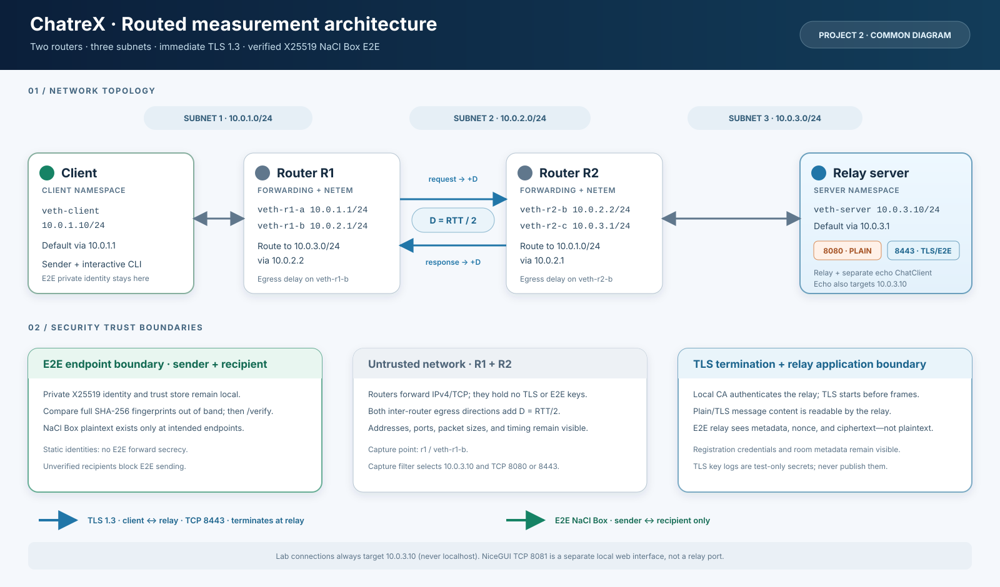

# ChatreX architecture

This is the common architecture for the implementation, routed measurements, packet captures, and report. The full lab has two routers and three IPv4 subnets; no routed-lab connection targets localhost.

**Standalone figure:** [architecture.svg](architecture.svg) (suitable for insertion into the report).

## 1. Devices, interfaces, and addressing

| Device / namespace | Interface and address | Default route / role |
|---|---|---|
| `client` | `veth-client`: **10.0.1.10/24** | Default via `10.0.1.1`; interactive sender and benchmark `sender` ChatClient. |
| `r1` | `veth-r1-a`: **10.0.1.1/24**; `veth-r1-b`: **10.0.2.1/24** | IPv4 forwarding; route `10.0.3.0/24` via `10.0.2.2`; netem on `veth-r1-b`. |
| `r2` | `veth-r2-b`: **10.0.2.2/24**; `veth-r2-c`: **10.0.3.1/24** | IPv4 forwarding; route `10.0.1.0/24` via `10.0.2.1`; netem on `veth-r2-b`. |
| `server` | `veth-server`: **10.0.3.10/24** | Default via `10.0.3.1`; relay and benchmark `echo` ChatClient. |

| Subnet | Link | Connected addresses |
|---|---|---|
| **10.0.1.0/24** | Client access | `10.0.1.10` ↔ `10.0.1.1` |
| **10.0.2.0/24** | Router-to-router | `10.0.2.1` ↔ `10.0.2.2` |
| **10.0.3.0/24** | Server access | `10.0.3.1` ↔ `10.0.3.10` |

### Delay in both directions

For target added RTT `R`, setup configures `D = R/2` as **egress** delay on both inter-router interfaces:

- Client → server requests cross `r1/veth-r1-b` and incur `D`.
- Server → client responses cross `r2/veth-r2-b` and incur `D`.
- A request/response round trip therefore incurs `D + D = R`, plus baseline path and processing time.

Loss and jitter, when supplied to `setup_topology.sh`, are applied to those same egress qdiscs. The required full matrix uses 20/100/200 ms RTT with zero loss and zero jitter. The benchmark reconfigures and validates the two qdiscs for each RTT block and records measured ping RTT rather than treating configured delay as a measurement.

## 2. Ports and process placement

| Endpoint | TCP port | Protocol / purpose |
|---|---:|---|
| Relay `10.0.3.10` | **8080** | Plaintext baseline only. Registration must specify `plaintext`. |
| Relay `10.0.3.10` | **8443** | Immediate TLS 1.3 handshake, then length-framed registration for `tls` or `e2e`. |
| NiceGUI, default `127.0.0.1` | **8081** | Separate web dashboard; not a relay listener and not part of the routed data path by default. |
| Clients | Ephemeral | Outbound TCP source ports selected by the OS. |

The benchmark relay listens on `0.0.0.0` inside the `server` namespace. Its echo bot is a **separate real ChatClient**, also launched in the `server` namespace, and connects to the relay at `10.0.3.10`. The sender runs in `client` and connects to that same routed address. Thus sender traffic crosses all three subnets, while the echo-to-relay hop remains within the server namespace. No lab worker uses `127.0.0.1` or `localhost`.

## 3. Mermaid topology

```mermaid
flowchart LR
    C["CLIENT namespace<br/>veth-client: 10.0.1.10/24<br/>default via 10.0.1.1<br/>sender / CLI"]
    R1["R1 namespace · IPv4 forwarding<br/>veth-r1-a: 10.0.1.1/24<br/>veth-r1-b: 10.0.2.1/24"]
    R2["R2 namespace · IPv4 forwarding<br/>veth-r2-b: 10.0.2.2/24<br/>veth-r2-c: 10.0.3.1/24"]
    S["SERVER namespace<br/>veth-server: 10.0.3.10/24<br/>relay + separate echo client<br/>TCP 8080 plain · TCP 8443 TLS/E2E"]

    C <--> |"Subnet 1 · 10.0.1.0/24"| R1
    R1 -->|"Subnet 2 · request →<br/>netem D = RTT/2"| R2
    R2 -->|"Subnet 2 · response →<br/>netem D = RTT/2"| R1
    R2 <--> |"Subnet 3 · 10.0.3.0/24"| S

    N["NiceGUI web UI<br/>127.0.0.1:8081 by default<br/>chat relay selected independently"]
    N -.->|"independent UI, not the relay path"| C
```

The SVG is the authoritative presentation figure; the Mermaid version is provided for maintainable inline editing.

## 4. Wire protocol and application flow

Every application frame is a **4-byte unsigned big-endian length** followed by exactly that many bytes of compact UTF-8 JSON. The JSON object requires integer `v: 1` and a nonempty string `type`. Zero-length and over-1 MiB frames are rejected, as are partial frames, malformed UTF-8/JSON, noncanonical Base64, and invalid fields. Application payloads are Base64-encoded inside JSON and limited to 65,536 decoded bytes.

| Step | Direction | Frame / operation | Important fields and behavior |
|---:|---|---|---|
| 0 | Client → relay | TCP connect; TLS when secure | Port 8080 remains plaintext. On 8443, the server wraps the accepted socket in TLS 1.3 **before reading any application frame**. Clients require the local CA, hostname/IP verification, and exactly TLS 1.3. |
| 1 | Client → relay | `register` | `action: create|join`, `mode`, `username`, `password`, and `room_name` or six-digit `room_code`; E2E also includes the 32-byte public key in Base64. The listener/mode combination is enforced. |
| 2 | Relay internal | Room creation/authentication | Create allocates a unique six-digit code and stores a 16-byte salt with PBKDF2-HMAC-SHA-256 (200,000 iterations). Join recomputes and constant-time compares the digest. The relay does not retain the plaintext password after registration. |
| 3 | Relay → client | `welcome`, then `roster` | Welcome confirms mode, username, room code/name. Roster lists other members; E2E entries include advertised public keys. Serialized roster updates follow joins/leaves. |
| 4 | Both clients local | E2E fingerprint verification | Each computes the full domain-separated SHA-256 fingerprint over username + public key. Users compare out of band and explicitly pin room/username/key. Advertisement alone never establishes trust. |
| 5 | Plain/TLS client → relay | `send` | `to` is a username or `*`, plus `id` and Base64 `data`. The relay decodes for validation and forwards to ready room members. Broadcast excludes the sender. |
| 6 | Relay → plain/TLS recipient | `deliver` | Adds authenticated-by-room-membership `from`, actual `to`, original `id`, and original Base64 `data`. TLS protects transport only; the relay handles plaintext application data. |
| 7 | E2E client → relay | `e2e_send` | One specific recipient, original message ID, fresh 24-byte nonce, and ciphertext. The sender uses its private X25519 identity and the **verified** recipient public key to seal an inner envelope with NaCl Box. Wildcards are forbidden. |
| 8 | Relay → E2E recipient | `e2e_deliver` | Relay validates envelope shape/length and forwards the original nonce/ciphertext. It has no private identity keys and performs no Box decryption. Recipient authenticates/decrypts, checks sender/recipient/ID inner metadata, and rejects unverified senders or replayed IDs. |
| Any | Relay → client | `error` | Stable error `code` and safe `message`; malformed or mode-inconsistent clients are rejected without affecting other rooms. |

In NaCl Box, X25519 establishes the pairwise shared key and the Box construction supplies authenticated encryption. The encrypted inner JSON contains `v`, `kind: data`, `id`, `from`, `to`, and Base64 `data`; outer ciphertext modification or metadata substitution fails authentication/validation.

## 5. Benchmark echo flow

1. `echo` creates the room through the relay; `sender` joins the same room in the same mode.
2. For E2E, both generate independent identities. The benchmark passes their full fingerprints through run-directory coordination files and both call the same explicit verification API used by interactive clients. This is benchmark-controlled out-of-band coordination, not automatic trust based on a roster.
3. The sender precomputes deterministic, unique payloads from the suite seed and run ID.
4. For each sequence, the sender transmits directly to `echo` and waits for the matching reply before sending the next payload. Echo validates sender, recipient, sequence-derived message ID, and exact bytes, then returns the same ID and payload directly to `sender`.
5. The sender validates the echo and records receive time. `latencies.csv` therefore measures one complete application request/echo round trip, including routed network delay and processing, not a one-way delay or raw ping.
6. Each run starts a fresh relay and fresh clients. Secure benchmark runs reject TLS session reuse. CPU and capture windows are recorded independently in `run.json`.

## 6. Security and trust boundaries

| Boundary | Protected assets | What crosses the boundary |
|---|---|---|
| Local CA / relay certificate | CA key signs the server certificate; server private key belongs only to the relay. Clients trust `certs/ca.crt` and verify `10.0.3.10` in the lab. | TLS 1.3 on 8443 protects each client↔relay transport session. It does not make message content opaque to the relay. |
| Plaintext baseline | None on the network path. | Registration credentials and application JSON are visible to routers, relay, and network observers on 8080. Use only in the isolated lab. |
| E2E endpoint boundary | Sender/recipient private X25519 identity files and verified room-scoped trust stores remain at endpoints. | Only public keys enter rosters. NaCl Box plaintext exists at sender and intended recipient; R1, R2, and relay see outer metadata, nonce, and ciphertext. |
| Relay application boundary | Room membership, password verifiers, rosters, routing state. | Relay necessarily sees registration passwords, usernames, room events, recipients, IDs, sizes, and timing. In plain/TLS it also sees payload bytes; in E2E it cannot read authenticated message content when fingerprints were verified independently. |
| Evidence/debug boundary | TLS key logs can decrypt captured TLS sessions. | Key logs expose transport plaintext, including registration and TLS-mode content, but do not reveal E2E inner plaintext without endpoint private keys. They are test-only secrets and must not be published. |

Static X25519 identities do **not** provide E2E forward secrecy or post-compromise security. E2E also does not hide traffic analysis metadata or prevent relay denial of service. Out-of-band fingerprint authentication is therefore a required part of the security design, not an optional UI detail.
